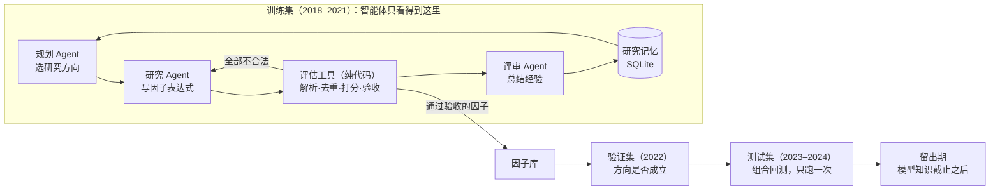

中文 | [English](README_EN.md)

# TimeFence：杜绝未来函数的 A 股因子挖掘多智能体系统

TimeFence 用三个 LLM 角色（规划、研究、评审）在 A 股日线数据上自动挖掘选股因子，再用一套遵守 A 股交易规则的回测检验它们。名字里的"围栏"（fence）指这个项目最核心的约束：**系统里任何一步都拿不到决策时刻之后的数据**，这一点由代码和测试保证，而不是靠提示词提醒模型。

> 状态：代码和测试已完成，在模拟行情上端到端跑通；**真实数据的结果还没有跑**（需要能访问东方财富和模型接口的环境）。下面"结果"一节在跑完前保持空白，模拟数据的数字不算研究结果。

## 它做什么



1. **挖掘（只用训练集）**：规划 Agent 根据研究记忆选一个方向（比如"短期反转""量价相关"），研究 Agent 写出几个因子表达式和理由，评估工具在训练集上算 IC、分组收益、换手和与已有因子的相关性，用写死在代码里的规则决定收不收，评审 Agent 总结这一轮学到了什么，写回记忆。
2. **验证**：挖掘结束后，入库因子在 2022 年上检查方向是否还成立，成立的才进组合。
3. **测试**：把保留的因子合成一个打分，每 5 天持有得分最高的 50 只股票，在 2023–2024 年回测一次，和同一股票池的等权组合比。
4. **对照**：同样的流程跑"随机表达式"和"经典人工因子"两个基线，看 Agent 是否真的更好。

## 怎么杜绝未来函数

| 风险 | 做法 | 在哪里检查 |
|---|---|---|
| 因子公式偷看明天 | 因子语言是白名单，没有"往前移"的算子，窗口必须是正整数常量 | `tests/test_dsl.py`、`tests/test_ops.py` |
| 计算时混进了未来数据 | 每条行情带 `available_at`（当天 15:00）；策略只拿到 `FencedData`，它按决策时间切数据，再检查一遍，越界就抛 `LeakError` | `tests/test_fence.py` |
| 某处实现悄悄用了未来 | **截断等价测试**：把某天之后的数据全部删掉重算，因子值必须一模一样（随机生成表达式反复测） | `tests/test_fence.py`、`timefence audit` |
| 智能体拿到验证/测试期数据 | Agent 的数据对象由 `store.slice_until(训练集结束日)` 构建，物理上不含之后的数据；工具类构造时再检查一遍 | `tests/test_agents.py` |
| 股票池用了"今天的成分股" | 每天按过去 20 天成交额选前 500 只，已退市股票保留在数据里 | `tests/test_universe.py` |
| 股票名称泄露未来（如后来变成 *ST） | 策略看到的股票表去掉名称，退市日期只在退市之后才可见 | `tests/test_fence.py` |
| 标签期和训练集末尾重叠 | 每个窗口最后 h+1 天不打分（purge） | `tests/test_evaluate.py` |
| 大模型"记得"历史行情 | 最终检查放在留出期，起点跟着所用模型的知识截止走 | `--holdout` |

## 快速开始

需要 Python 3.11+ 和 [uv](https://docs.astral.sh/uv/)。

```bash
git clone https://github.com/yuhang2551/timefence-mini.git
cd timefence-mini
uv sync --group dev          # 安装依赖
uv run pytest                # 跑全部测试
```

### 不联网的演示（模拟行情 + 离线替身）

```bash
uv run timefence data synth --out data/synth
uv run timefence run --data data/synth --out runs/demo-agent --method agent --offline --top-n 150 --top-k 20
uv run timefence run --data data/synth --out runs/demo-random --method random --top-n 150 --top-k 20
uv run timefence compare runs/demo-agent runs/demo-random
```

`--offline` 用模板替身代替大模型，报告里会醒目标注"不是大模型""模拟行情"。

### 真实数据

先装数据依赖，下载全部 A 股日线（含已退市，2016 年起，可断点续传），再跑一遍防穿越自检：

```bash
uv sync --extra data
uv run timefence data download --out data/ashare
uv run timefence audit --data data/ashare
```

两个基线不调用模型，没有 key 也能跑：

```bash
uv run timefence run --data data/ashare --out runs/random --method random --trials 40
uv run timefence run --data data/ashare --out runs/handcrafted --method handcrafted
```

Agent 需要模型的 key。先复制配置模板：

```bash
cp .env.example .env
```

在 `.env` 里填上所用服务商的 key（默认 Claude：`ANTHROPIC_API_KEY`），再跑 Agent 和对比：

```bash
uv run timefence run --data data/ashare --out runs/agent --method agent
uv run timefence compare runs/agent runs/random runs/handcrafted
```

`.env` 已在 `.gitignore` 里，不会提交；key 也可以直接放在环境变量里，不要写进代码。key 没填时，Agent 运行会在开始前就报错。

每次运行在 `runs/<名字>/` 下生成：`report.md`（中文报告）、`summary.json`、`memory.sqlite`（每个尝试过的因子和原因）、`transcript.jsonl`（每次模型调用的完整输入输出）、`nav.csv`、`fills.csv`。模型的回复按请求内容缓存在 `.cache/llm/`，重跑同一个实验不再花钱，结果也能复现。

### 换模型

模型层可以替换，`--provider` 选服务商，默认 `claude`：

| `--provider` | 默认模型 | 环境变量 | 留出期默认起点 |
|---|---|---|---|
| `claude`（默认） | `claude-haiku-5-5`（最便宜的 Claude 模型） | `ANTHROPIC_API_KEY` | 2026-07-01（知识截止 2026 年 6 月） |
| `k2` | K2 Horizon 375B（MBZUAI 基础模型研究院，`IFM/K2-Horizon-375B-A23B`） | `K2_API_KEY` | 2026-09-03（没有公布知识截止，按发布日） |
| `deepseek` | `deepseek-flash` | `DEEPSEEK_API_KEY` | 2026-10-17（没有公布知识截止，按当前版本发布日） |

- Claude 走官方 Anthropic SDK，默认用最便宜的 Claude Haiku 5.5；`--model claude-opus-5-5` 更强也更贵，知识截止相同，留出期不变。它总是先思考再回答，用 `--effort` 调思考深度（默认 `high`），温度由模型自己定。
- K2 Horizon 走兼容 OpenAI 协议的接口，默认用 IFM 自己的接口 `https://api.ifm.ai/v1`。换其他服务商的接口时，地址填在 `K2_BASE_URL`；模型名不是 `IFM/K2-Horizon-375B-A23B` 的，填在 `K2_MODEL`（同一个模型换个名字，留出期不变）。它总是先推理再回答，`--effort low|medium|high` 调推理深度（默认 `high`），温度等采样参数按模型说明固定为 temperature 1.0、top_p 0.95。
- DeepSeek 也走兼容 OpenAI 协议的接口，默认关闭思考模式（DeepSeek 默认打开），回复快、成本低；要打开就加 `--thinking enabled`。
- 其他兼容 OpenAI 协议的模型：`--provider deepseek --model <名字> --base-url <地址> --api-key-env <环境变量名>`，服务商不认识思考模式参数时再加 `--thinking omit`。用的不是上面登记过的模型时，要用 `--holdout-start` 写明留出期从哪天开始（该模型知识截止的第二天）。

**留出期跟着模型走。** 测试集（2023–2024）挡的是反复试错带来的过拟合，但模型训练时很可能见过那几年的行情；只有模型知识截止之后的数据，才是它确实没见过的。所以留出期默认从所选模型的知识截止之后开始，训练、验证、测试集都在它之前。几次要放在一起比的运行（两个基线和 Agent）用同一个 `--provider`，留出期才一致。留出期至少要有 60 个交易日才跑：按 2026 年 10 月的数据，Claude 大约有 4 个月；K2 Horizon 只有一个半月左右，要到 2026 年 12 月初才够；DeepSeek 还差得远。

## 结果

真实数据跑完后填写。表格会是这样：

| 方法 | 打分次数 | 训练通过 | 验证保留 | 测试 RankIC 均值 | 年化超额 | 信息比率 | 年换手 |
|---|---|---|---|---|---|---|---|
| 多智能体挖掘 | | | | | | | |
| 随机表达式基线 | | | | | | | |
| 经典因子基线 | | | | | | | |

## 代码结构

```
src/timefence/
  core/         时间、窗口、时钟、异常（最底层，不依赖别的模块）
  data/         行情存储、时间围栏 FencedData、股票池、下载、模拟行情
  factors/      因子语言（白名单）、算子、因子评估（IC、分组、换手、相关性）
  backtest/     A 股规则、交易成本、模拟券商、回测循环、绩效指标
  strategy/     多因子合成打分、TopK 选股
  agents/       LLM 客户端（缓存+预算）、研究记忆、评估工具、LangGraph 流程
  experiments/  基线、实验流程（训练→验证→测试）、中文报告
  cli.py        命令行
tests/          每一层的测试，重点是防穿越
docs/           架构说明、设计决策（ADR）、读代码指南
```

依赖方向只能向下（`cli → experiments → agents → strategy → backtest/factors → data → core`），由 `uv run lint-imports` 检查。

## 已知的简化

- ST 股票的涨跌停是 5%，但没有历史 ST 标记，按所在板块处理；流动性前 500 的股票池里很少有 ST。
- 所有板块都按 100 股一手（科创板实际 200 股起、之后可以 1 股递增）。
- 分红按除权日再投资处理（用复权因子调整持股数），不单独模拟现金分红到账和红利税。
- 持有的股票退市时按最后收盘价卖出，偏乐观；报告里会列出发生次数。
- 成交价是开盘价加 5 个基点滑点，不模拟冲击成本；规模大了需要更细的成交模型。

## 参考

- [R&D-Agent-Quant](https://arxiv.org/abs/2505.15155)、[AlphaAgent](https://arxiv.org/abs/2502.16789)、[QuantaAlpha](https://arxiv.org/abs/2602.07085)：LLM 因子挖掘的研究闭环
- [Qlib](https://github.com/microsoft/qlib)：因子体系、时点数据库、回测
- 设计文档：[docs/architecture.md](docs/architecture.md)、[docs/adr/](docs/adr/)；读代码从 [docs/guide_zh.md](docs/guide_zh.md) 开始；每次改了什么见 [CHANGELOG.md](CHANGELOG.md)
