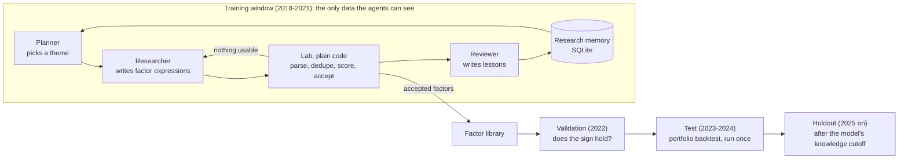

[中文](README.md) | English

# TimeFence: an A-share factor-mining multi-agent system that cannot see the future

TimeFence uses three LLM roles (planner, researcher, reviewer) to mine daily stock-selection factors on China A-share data, then tests them with a backtest that follows A-share trading rules. The "fence" is the project's core constraint: **no step of the system can reach data from after the decision time**. Code and tests enforce this; prompts do not.

> Status: code and tests are done and the pipeline runs end to end on a synthetic market. **Results on real data have not been produced yet** (they need an environment that can reach Eastmoney and a model API). The results section stays empty until then; numbers from synthetic data are not research results.

## What it does



1. **Mining, training data only.** The planner reads the research memory and picks a theme (for example short-term reversal or price-volume correlation). The researcher proposes a few factor expressions with a rationale. The lab scores them on the training window (IC, quintile returns, turnover, correlation with accepted factors) and applies acceptance rules written in code. The reviewer writes lessons back to memory.
2. **Validation.** After mining stops, each accepted factor is checked on 2022; only factors whose sign holds go forward.
3. **Test.** The kept factors are combined into one score; the top 50 stocks are held in equal weights, rebalanced every 5 days, and backtested once on 2023-2024 against an equal-weight portfolio of the same universe.
4. **Baselines.** The same pipeline runs random expressions and well-known handcrafted factors, to show whether the agents add anything.

## How the fence works

| Risk | Defence | Checked in |
|---|---|---|
| A formula peeks at tomorrow | The factor language is a whitelist with no operator that shifts data backwards; windows must be positive integer literals | `tests/test_dsl.py`, `tests/test_ops.py` |
| Future data slips into a computation | Every bar carries `available_at` (15:00 that day). Strategies only get a `FencedData` view, which cuts every query at the decision time and raises `LeakError` if anything later gets through | `tests/test_fence.py` |
| Some implementation quietly uses the future | **Truncation test**: delete all data after a day and recompute; factor values must be identical (random expressions, property-based) | `tests/test_fence.py`, `timefence audit` |
| Agents see validation or test data | The agents' data is built from `store.slice_until(train_end)`, so later data is physically absent; the lab refuses anything else | `tests/test_agents.py` |
| Today's index members leak survivorship | The universe is the top 500 stocks by 20-day turnover on each day, delisted stocks included | `tests/test_universe.py` |
| Stock names leak the future (a later *ST) | The stock table a strategy sees has no names, and a delisting shows only after it happened | `tests/test_fence.py` |
| Label periods overlap the next window | The last h+1 days of every window are not scored (purge) | `tests/test_evaluate.py` |
| The LLM remembers market history | The final check runs on a holdout after the model's knowledge cutoff | `--holdout` |

## Quick start

Needs Python 3.11+ and [uv](https://docs.astral.sh/uv/).

```bash
uv sync --group dev
uv run pytest
```

Offline demo (synthetic market, template stand-in instead of a model; reports say so prominently):

```bash
uv run timefence data synth --out data/synth
uv run timefence run --data data/synth --out runs/demo-agent --method agent --offline --top-n 150 --top-k 20
uv run timefence run --data data/synth --out runs/demo-random --method random --top-n 150 --top-k 20
uv run timefence compare runs/demo-agent runs/demo-random
```

Real data:

```bash
uv sync --extra data                                   # akshare
uv run timefence data download --out data/ashare       # all A-shares incl. delisted, from 2016, resumable
uv run timefence audit --data data/ashare              # look-ahead self-check
export DEEPSEEK_API_KEY=...                            # environment only, never in code or config
uv run timefence run --data data/ashare --out runs/agent --method agent
uv run timefence run --data data/ashare --out runs/random --method random --trials 40
uv run timefence run --data data/ashare --out runs/handcrafted --method handcrafted
uv run timefence compare runs/agent runs/random runs/handcrafted
```

Each run writes `report.md` (in Chinese), `summary.json`, `memory.sqlite` (every factor tried and why it passed or failed), `transcript.jsonl` (every model call in full), `nav.csv` and `fills.csv` under `runs/<name>/`. Model replies are cached in `.cache/llm/` by request, so re-running an experiment costs nothing and gives the same result. Any OpenAI-compatible model works: `--model <name> --base-url <url> --api-key-env <variable>`.

## Results

To be filled in after the real-data runs:

| Method | Factors scored | Accepted on train | Kept on validation | Mean test RankIC | Annual excess return | Information ratio | Annual turnover |
|---|---|---|---|---|---|---|---|
| Multi-agent mining | | | | | | | |
| Random expressions | | | | | | | |
| Handcrafted factors | | | | | | | |

## Layout

```
src/timefence/
  core/         time, windows, clock, errors, fast rolling statistics
  data/         market store, FencedData, universe, download, synthetic market
  factors/      factor language, operators, factor scoring
  backtest/     A-share rules, costs, simulated broker, event loop, metrics
  strategy/     multi-factor score, top-K selection
  agents/       LLM client (cache and budget), research memory, lab, LangGraph loop
  experiments/  baselines, train/valid/test pipeline, reports
  cli.py        command line
```

Imports only go downward (`cli -> experiments -> agents -> strategy -> backtest | factors -> data -> core`), checked by `uv run lint-imports`. Design notes are in [docs/architecture.md](docs/architecture.md) and [docs/adr/](docs/adr/) (in Chinese).

## Known simplifications

- ST stocks really have a 5% limit; without historical ST flags they get their board's limit. A top-500 liquidity universe rarely contains them.
- Every board trades in 100-share lots (the STAR board really allows 200 shares and up in steps of 1).
- Dividends are reinvested on the ex-date through the adjustment factor; cash dividend timing and dividend tax are not modelled.
- A holding that delists is sold at its last close, which is optimistic; reports count these cases.
- Fills are at the open plus 5 bp slippage, with no market impact model.

## References

- [R&D-Agent-Quant](https://arxiv.org/abs/2505.15155), [AlphaAgent](https://arxiv.org/abs/2502.16789), [QuantaAlpha](https://arxiv.org/abs/2602.07085): research loops for LLM factor mining
- [Qlib](https://github.com/microsoft/qlib): factor sets, point-in-time database, backtesting
