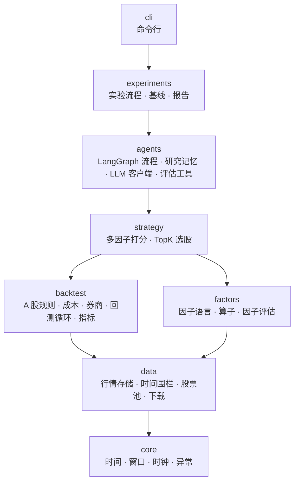
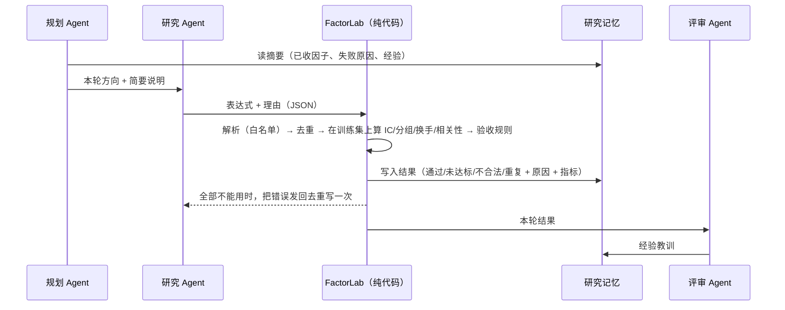
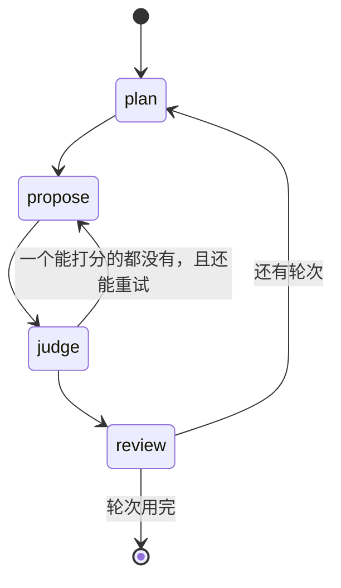

# 架构说明

这份文档讲清楚三件事：代码分几层、数据怎么流、为什么这样分。具体每个决定的取舍见 [adr/](adr/)。

## 1 分层



规则只有一条：**上层可以用下层，下层不能用上层**（`uv run lint-imports` 检查）。好处是每一层都能单独测试，换掉上层（比如换一种 Agent 编排）不会动到下层。

| 层 | 负责什么 | 关键类/函数 |
|---|---|---|
| core | 时间点、时间窗口、模拟时钟、异常类型 | `Window`、`Split`、`SimClock`、`LeakError` |
| data | 存行情、按时间切数据、选股票池、下载 | `MarketStore`、`FencedData`、`UniverseConfig`、`download` |
| factors | 因子表达式的解析与计算、因子打分 | `dsl.parse`、`dsl.evaluate`、`ResearchContext`、`evaluate_factor`、`AcceptanceRules` |
| backtest | 按 A 股规则模拟成交，算绩效 | `MarketTape`、`Broker`、`run_backtest`、`performance` |
| strategy | 把多个因子合成一个分数，选股 | `FactorModel`、`TopKStrategy` |
| agents | 三个 LLM 角色的流程、记忆、工具、模型客户端 | `ResearchAgent`、`FactorLab`、`ResearchMemory`、`OpenAICompatibleLLM` |
| experiments | 训练 → 验证 → 测试的完整实验、基线、报告 | `run_experiment`、`run_random`、`run_handcrafted`、`write_report` |

`backtest` 和 `factors` 在同一层，互相不依赖：回测不关心信号怎么来的，因子也不关心怎么交易。

## 2 时间：一切的基础

```mermaid
timeline
    title 第 t 天到第 t+1 天
    t 日 15:00 : 收盘，当天日线可用（available_at）
    t 日 15:30 : 决策时刻 as_of，策略拿到截止到此刻的数据，给出目标持仓
    t+1 日 09:30 : 券商用开盘价成交（检查停牌、涨跌停、T+1、整手）
    t+1 日 15:00 : 按收盘价给持仓估值，记录净值
```

- 每条日线都带 `available_at = 交易日 + 15:00`。
- 策略拿到的不是 `MarketStore`，而是 `FencedData(store, as_of)`：它只返回 `available_at <= as_of` 的行，并且在返回前再核对一遍，发现越界就抛 `LeakError`。
- 时钟（`SimClock`）只由回测框架推进，策略和 Agent 改不了日期。
- 因子的"标签"是 t+1 开盘买、t+1+h 开盘卖的收益（`forward_open_returns`），它天然看未来，所以只有因子评估函数能碰它。

## 3 一个因子的一生



挖掘结束之后（Agent 已经停了）：

1. **验证**：在 2022 年上重新算每个入库因子的 RankIC，方向和训练集一致、|ICIR| ≥ 0.1 的保留。
2. **测试**：保留的因子按训练集方向合成打分（截面 z 分数的平均），TopK 等权持有，按 A 股规则回测 2023–2024，只跑一次。
3. **留出期**（可选）：默认 2026 年起的数据，在模型知识截止之后（换模型时用 `--holdout-start` 调整），最后确认一次。

## 4 Agent 流程（LangGraph）



状态（`RoundState`）只有几个字段：轮次、方向、说明、本轮提案、给重试用的错误信息、重试次数、本轮结果文本。长期的东西不放在状态里，放在 SQLite 研究记忆里，所以中途停下来（比如预算用完）不会丢已经做完的工作。

三个角色为什么分开：

- **规划**只决定"这轮研究什么"，看的是全局（哪些方向有收获、哪些一直失败），避免一直在同一个方向打转。
- **研究**只负责写表达式，提示词里有完整的因子语言说明和验收规则。
- **评审**只总结经验，写回记忆，影响之后的规划和研究。
- **判断收不收**不是任何一个 LLM 角色的事，是 `FactorLab` 里的代码。模型说得再好，过不了规则就进不了库。

## 5 关键接口

```python
class PanelSource(Protocol):          # core/types.py：MarketStore 和 FencedData 都满足
    def panel(self, field: str) -> pd.DataFrame: ...
    @property
    def stocks(self) -> pd.DataFrame: ...

class Strategy(Protocol):             # backtest/engine.py：回测只认这个
    lookback: int
    def target_weights(self, data: FencedData, holdings: Mapping[str, float]) -> pd.Series | None: ...

class LLM(Protocol):                  # agents/llm.py：真模型、离线替身、测试替身都满足
    budget: Budget
    name: str
    def complete(self, messages: Messages, temperature: float = 0.7) -> LLMReply: ...
```

接口定在"消费方"那一层：回测定义它需要的 `Strategy`，策略层去实现它，所以回测不用依赖策略层。

## 6 怎么扩展

| 想做的事 | 改哪里 | 要加的测试 |
|---|---|---|
| 加一个算子 | `factors/ops.py` 写函数，`factors/dsl.py` 的 `OPS` 登记 | `tests/test_ops.py` 会自动对它做"改未来不影响过去"测试 |
| 加一个数据字段（如换手率） | `data/schema.py`、`data/ingest.py`、`MarketStore._build_panel`、`dsl.FIELDS` | 截断等价测试会自动覆盖 |
| 加一个 Agent 角色 | `agents/prompts.py` 写提示词，`agents/graph.py` 加节点和边 | 用 `ScriptedLLM` 写流程测试 |
| 换模型 | 命令行 `--model --base-url --api-key-env` | 无 |
| 换选股方式 | 在 `strategy/` 写一个满足 `Strategy` 的类 | 回测规则测试已覆盖成交部分 |
